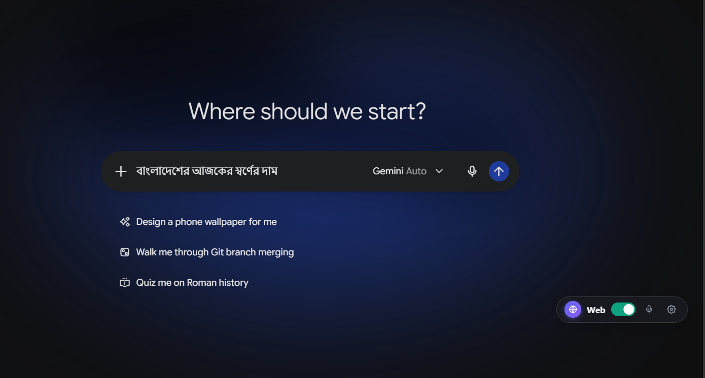
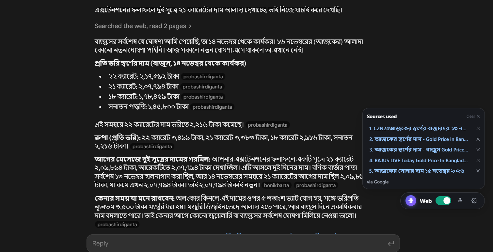
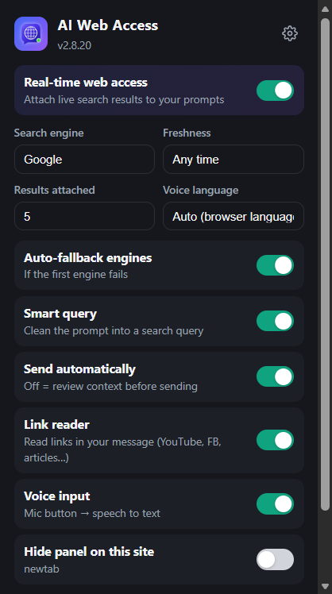
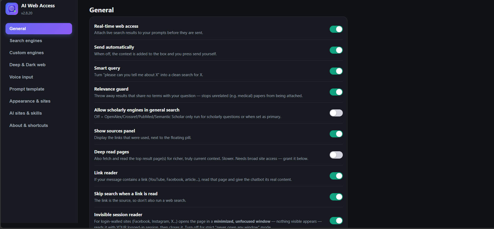
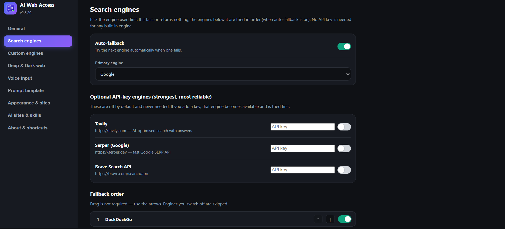
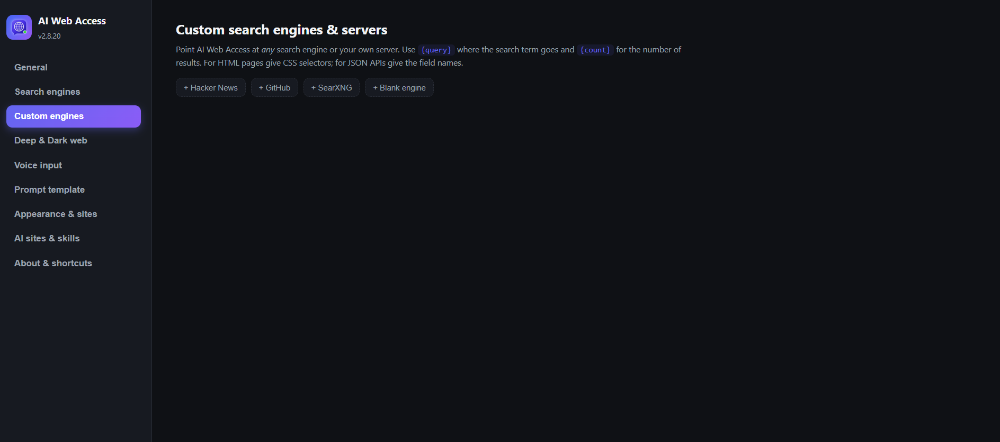
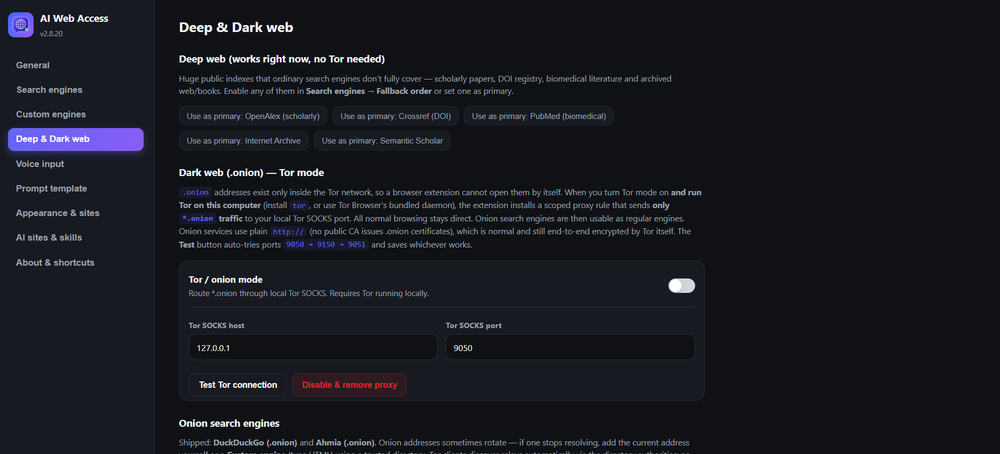
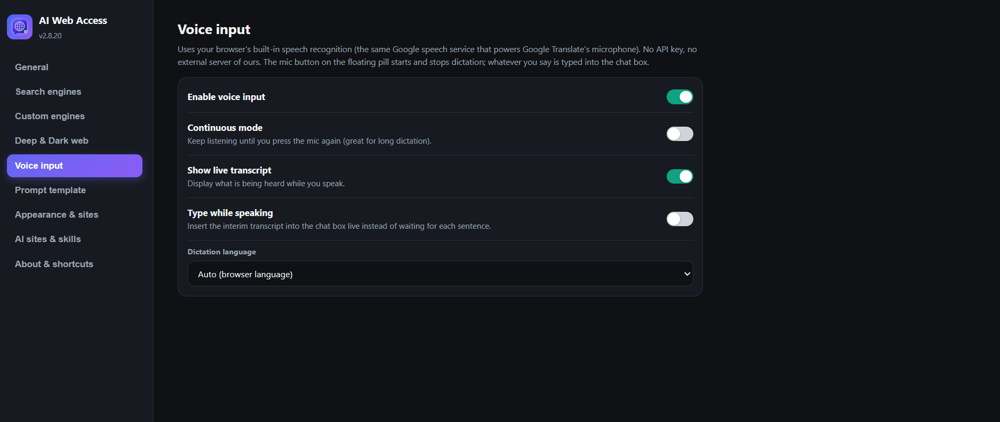
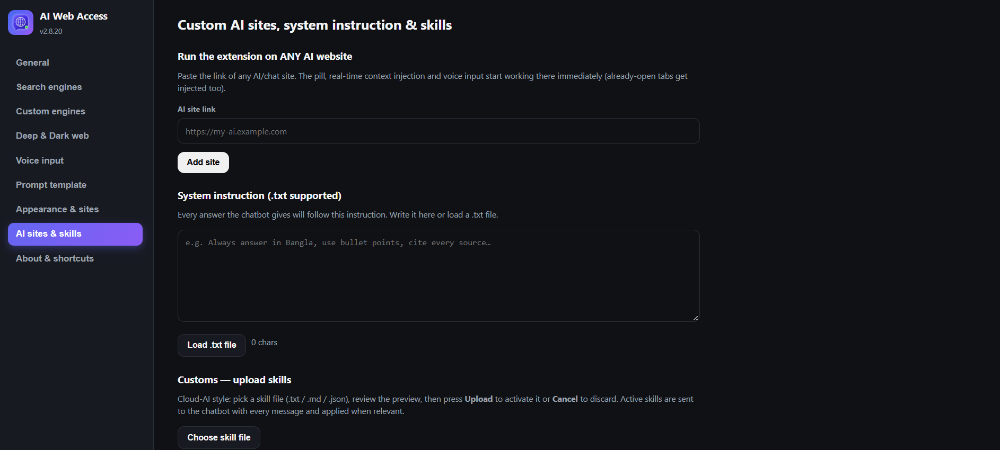
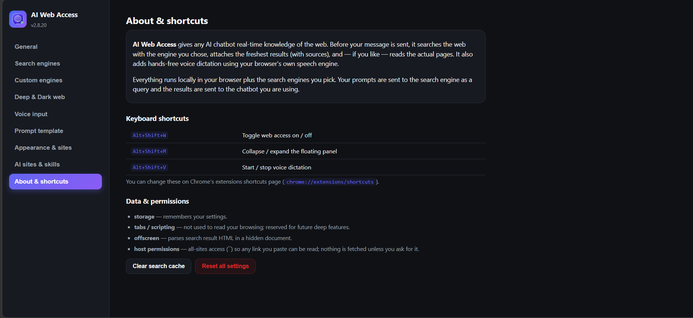

# 🌐 AI Web Access

**Real-time web search, link reading and voice dictation for AI chat sites — as a Chrome / Edge extension.**

Before your message is sent to ChatGPT, Claude, Gemini, DeepSeek, Grok and ~20 other chatbots, the extension searches the web with the engine **you** choose, attaches the freshest results (with source links and a timestamp), and then lets the message go. The chatbot answers from live data instead of its training cut-off.

   

<p align="center">
  
</p>

> **বাংলায় সংক্ষেপে:** এই এক্সটেনশন যেকোনো এআই চ্যাটবটে আপনার বার্তা পাঠানোর আগে নিজে ওয়েবে সার্চ করে, সদ্য পাওয়া ফলাফল (সূত্র ও সময়সহ) বার্তার সঙ্গে জুড়ে দেয়। ফলে এআই পুরোনো তথ্যের বদলে লাইভ তথ্য থেকে উত্তর দিতে পারে। কোনো API key লাগে না। লিংক দিলে পেজটি পড়ে এআইকে দেয়, আর মাইক দিয়ে বাংলা/ইংরেজিতে কথা বলে লেখাও যায়। বিস্তারিত বাংলা গাইড: [`GUIDE-bn.md`](GUIDE-bn.md)।

---

## Table of contents

- [Screenshots](#screenshots)
- [Features](#features)
- [Install](#install)
- [How it works](#how-it-works)
- [Search engines](#search-engines)
- [Supported chat sites](#supported-chat-sites)
- [Settings](#settings)
- [How to test that it really works](#how-to-test-that-it-really-works)
- [Troubleshooting](#troubleshooting)
- [Honest limits](#honest-limits)
- [Privacy & permissions](#privacy--permissions)
- [What was fixed (v2.8.11 → v2.8.20)](#what-was-fixed-v2811--v2820)
- [Project structure](#project-structure)
- [License](#license)

---

## Screenshots

### A real answer with live sources

The chatbot answered a Bangladesh gold-price question from sources the extension attached (right side: **Sources used**). When two sources disagreed, the chatbot noticed and checked.

<p align="center"></p>

### Toolbar popup

Quick switches: engine, freshness, number of results, fallback, smart query, auto-send, link reader, voice.

<p align="center"></p>

### Settings

| | |
|---|---|
| **General** — master switch, relevance guard, deep read, link reader, session reader<br> | **Search engines** — primary engine, optional API-key engines, fallback order<br> |
| **Custom engines** — point it at any search page or JSON API<br> | **Deep & Dark web** — scholarly indexes and optional Tor mode<br> |
| **Voice input** — browser speech recognition, any language<br> | **AI sites & skills** — add any AI site, system instruction, skills<br> |

### About & shortcuts

<p align="center"></p>

---

## Features

| Area | What you get |
|---|---|
| **Live search context** | Title, snippet and link of the top results, plus the retrieval time, are appended to your prompt before it is sent |
| **No API key** | All built-in engines work without a key (Tavily / Serper / Brave API are optional extras) |
| **Your engine wins** | The engine you pick is tried first. If it is blocked, the page is rendered once in your own browser session (minimized window) before a fallback may answer |
| **Auto-fallback** | If the primary engine fails or returns off-topic rows, the next engines are tried, within a time budget |
| **Relevance guard** | Off-topic results are dropped. Understands inflected Bengali (`স্বর্ণ` ↔ `স্বর্ণের`) and English plurals |
| **Smart query** | Long conversational messages become a short keyword query instead of being searched verbatim |
| **Freshness filter** | Any time / past hour / 24 h / week / month |
| **Link reader** | Paste a link (also without `https://`, e.g. `www.youtube.com/watch?v=…`) and the page's real content is given to the chatbot. YouTube: title, channel, subscribers, views, likes, date, description |
| **Live facts** | Time, date, Bangla calendar and your public IP (a search engine can never know these) are read locally / from echo services and attached |
| **Deep read** | Optionally fetch and read the top result page(s) |
| **Voice input** | Mic button → live transcript → typed into the chat box (browser speech API, no key) |
| **Any AI site** | Add any chat site in Settings → *AI sites & skills*; the panel, injection and voice start working there |
| **System instruction & skills** | A standing instruction and uploaded `.txt/.md/.json` skills are sent along with every message |
| **Deep web & Tor (optional)** | OpenAlex, Crossref, PubMed, Internet Archive, Semantic Scholar; `.onion` engines through your *own* local Tor |
| **Sources panel** | Shows exactly which links were used and, if your chosen engine lost, *why* |
| **Reliable sending** | Extra Enter presses during a search are swallowed; if the send button is missing or ignores the click, the extension presses Enter itself; an error inside the extension never blocks your message |

---

## Install

1. Download / clone this repository.
2. Open `chrome://extensions` (or `edge://extensions`).
3. Turn on **Developer mode**.
4. Click **Load unpacked** and pick this folder (the one containing `manifest.json`).
5. Open a supported chat site and **refresh it once (F5)**. The floating **🌐 Web** pill appears.

> After every *Reload* of the extension, press **F5** on open chat tabs once. (Since v2.8.9 the extension re-attaches itself, but a refresh guarantees a clean start.)

Requires Chrome / Edge **109+** (Manifest V3 + Offscreen API).

---

## How it works

```
You press Enter / click Send
        │  (the extension intercepts it)
        ▼
 1. Links in the message?  ──► Link Reader  (YouTube extractor → oEmbed → plain fetch → Facebook embed → minimized window with your session)
 2. Time / date / IP question? ──► Live facts (local clock, Bangla calendar, echo service)
 3. Clean search query  (smart query: keywords, no filler)
 4. Engine chain: your engine → (rendered in your browser if blocked) → fallbacks
 5. Relevance guard + time budget (≈16 s)
 6. Context block appended to your message:
        [Real-time web search results for "…" — retrieved <time>]
        1. Title — snippet
           Source: https://…
        Instructions: use relevant results, cite [n], say what is missing, never invent figures
 7. Send (button click → Enter fallback)   →   the chatbot answers from live data
```

The chatbot itself is **not** connected to the extension. It only reads the text that the extension adds to your message — this is why the answer quality depends on what was found and attached.

---

## Search engines

| Group | Engines |
|---|---|
| **Web (no key)** | DuckDuckGo (GET + POST), DuckDuckGo Lite, Bing, Bing RSS, Google, Google (standard), Google News RSS, Brave, Mojeek, Yahoo, Ecosia, Startpage, **Yandex**, SearXNG (searx.be, priv.au), Reddit, Wikipedia, DuckDuckGo Answers |
| **Scholarly / archives** | OpenAlex, Crossref, PubMed, Internet Archive, Semantic Scholar — only for scholarly questions or when chosen |
| **Dark web** | DuckDuckGo `.onion`, Ahmia `.onion` — only with Tor mode on and Tor running locally |
| **API (optional)** | Tavily, Serper (Google), Brave Search API — tried first when you add a key |
| **Custom** | Any HTML search page (CSS selectors) or JSON API (field names), `{query}` / `{count}` placeholders |

---

## Supported chat sites

ChatGPT · Claude · Gemini / Bard · DeepSeek · Kimi · Z.ai · Grok · Perplexity · Microsoft Copilot · Bing Chat · Meta AI · Mistral (Le Chat) · HuggingChat · LMArena · Arena.ai · You.com · Pi · Qwen — plus a **generic detector** for the message box and send button on any other site you add under *AI sites & skills*.

---

## Settings

| Setting | Meaning |
|---|---|
| **Real-time web access** | Master on/off (also `Alt+Shift+W`) |
| **Search engine / Fallback** | Primary engine and the ordered fallback list |
| **Freshness** | Recency filter. For prices and news use *Past 24 hours* or *Past week* so old pages do not mix in |
| **Results attached** | How many results are added |
| **Smart query** | Turn a chatty prompt into a clean search |
| **Send automatically** | Off = context is added and you press send yourself |
| **Relevance guard** | Drop results that do not match the question |
| **Link reader / Session reader** | Read pasted links; the session reader may open a *minimized* window to read login-walled pages with your own session |
| **Prompt template** | Editable, variables `{query}` `{results}` `{date}` |
| **Hide panel on this site** | Per-site hiding |
| **Shortcuts** | `Alt+Shift+W` toggle · `Alt+Shift+M` collapse panel · `Alt+Shift+V` voice |

---

## How to test that it really works

1. **Check the version** in the popup (it should read the version of this repository).
2. **Use a question you can verify:** e.g. *“বাংলাদেশের আজকের স্বর্ণের দাম”*, a news headline, or *“what is my IP?”* (compare with whatismyip.com).
3. **Look at the sent message:** in the chat history, below your text there is a `[Real-time web search results … retrieved …]` block. That is the proof of what was attached.
4. **A/B test:** ask the same question with the switch **on** and **off**.
5. **Use a chatbot without its own web search** (or switch that off) — otherwise you cannot tell which part came from the extension.
6. **Popup → Diagnose engines** shows `OK n rows / ERR reason` for every engine on *your* network.
7. **Footer of the Sources panel** tells you which engine answered, e.g. `via DuckDuckGo (POST) · yandex: CAPTCHA wall…`.
8. **Link test:** send a news or YouTube link; the chatbot should quote details from inside the page.

---

## Troubleshooting

| Symptom | Cause | Fix |
|---|---|---|
| Pill visible but messages are not enriched after an update | Old content script in an open tab | Press **F5** on the chat tab |
| I have to press Enter many times | Slow search + (before v2.8.19) leaked Enter presses | Update to ≥ 2.8.19; the extension now swallows extra Enters and sends once |
| Send click does nothing | Chat site ignored the programmatic click | ≥ 2.8.20 presses Enter itself after 1.3 s; if still failing open DevTools → Console and look for `[AI Web Access]` lines |
| `yandex: CAPTCHA wall (yandex.com)` | Yandex asks for a robot check | Open yandex.com in a normal tab once and pass the check. A captcha can only be solved by a person |
| `bing: results not relevant (e.g. "…Chinese title…")` | Cookie-less fetch got another market | Fixed in 2.8.19 (market is pinned). If it still happens, the real-browser render pass is used |
| Old prices mixed with new ones | Freshness = *Any time* | Set *Past 24 hours* / *Past week* |
| “Issues” badge on the extensions page | Result pages contain inline `onclick` handlers (CSP log noise) | Fixed in 2.8.13; click *Clear all* once |
| “(Inactive)” next to *service worker* | Normal for Manifest V3 idle state | Nothing to do |
| Facebook / Instagram link unreadable | Login wall | Log in to the site in this browser, resend |
| `.onion` does not work | Tor is not running locally | Install/run Tor (port 9050, or Tor Browser 9150) |

---

## Honest limits

- **“No limits” is not possible.** Login-protected pages, bot-blocked sites, CAPTCHAs, PDF text and `file://` links cannot be read by any extension. Public pages and news work well.
- The chatbot only sees text. It cannot control the extension and cannot see your browser.
- Search engines change their HTML. Selectors (especially **Yandex** and **Gemini’s send button**) are best-effort and may need updating; use *Diagnose engines*.
- Results can still be wrong or outdated. The extension adds sources and timestamps so you (and the chatbot) can check them.
- Tested with unit tests, manifest/import cross-checks and a simulated page (jsdom). Behaviour on the live sites depends on their current markup.

---

## Privacy & permissions

- **No server of ours.** There is no analytics, no tracking, no account. Settings and API keys are stored locally (`chrome.storage.local`).
- **What leaves your browser:** the *search query* (derived from your prompt) goes to the search engine you picked (and fallbacks); pasted links are fetched; time/IP questions contact `ipinfo.io` / `ipify.org` / `ifconfig.me`. The results are then placed into the message you send to your chatbot.
- **Do not put secrets in prompts** — part of the prompt becomes a web search query.

| Permission | Why |
|---|---|
| `host_permissions: <all_urls>` | Read any page you paste a link for; fetch search engines |
| `storage` | Keep settings |
| `scripting`, `tabs` | Find open chat tabs, re-attach the panel after updates, render a page in a minimized window when needed |
| `offscreen` | Parse HTML (the service worker has no DOM) |
| `declarativeNetRequest` | Header adjustments for this extension’s own search fetches |
| `proxy` | Only for Tor mode (`*.onion` only; everything else stays direct) |

---

## What was fixed (v2.8.11 → v2.8.20)

Found during a full source review and then user testing. Full technical notes: [`BUILD-NOTES.md`](BUILD-NOTES.md).

| Version | Fix |
|---|---|
| **2.8.11** | Search cache never expired (`0` meant “forever”) → stale results. Time/date/Bangla-calendar patterns were broken (`'\b'` in a normal string). Questions like “today bitcoin price” skipped the search. Link-failure notice crashed silently (temporal dead zone). The panel was injected into **every** open site after an update. Enter pressed twice stacked two context blocks. Custom engines lost same-site results. Relevance guard accepted one shared word. Prompt told the chatbot “use only the data above / never say unverified” → rewritten to “use relevant results, cite, say what is missing, never invent” |
| **2.8.12** | Long chatty prompts are searched as keywords, not verbatim. Search-engine pages’ own `/search?…` links were returned as “sources”. Low-confidence results on long messages are no longer attached |
| **2.8.13** | Links typed **without `https://`** (`www.youtube.com/…`, `youtu.be/…`) are recognised. CSP log noise (`inline event handler`) removed by sanitising parsed HTML |
| **2.8.14** | **Yandex** engine added |
| **2.8.15** | The user’s chosen engine was silently replaced by DuckDuckGo when blocked — it now gets the real-browser render pass first; the footer shows *why* it lost |
| **2.8.16** | Tells a **CAPTCHA wall** apart from broken selectors |
| **2.8.17** | On a captcha wall the page is opened in a normal tab (max once / 30 min) so a person can solve it |
| **2.8.18** | Relevance guard now understands Bengali inflection and English plurals; shows a sample of rejected titles |
| **2.8.19** | **Repeated-Enter problem:** extra Enters are swallowed, one message is sent, time budget for slow chains; Bing market pinned (a cookie-less fetch had returned a Chinese Q&A page); duplicate render pass removed |
| **2.8.20** | **“Send does nothing”:** `run()` can no longer leave the extension stuck (try/finally + 45 s watchdog + 30 s deadlines); ignored click → Enter fallback; a dead (reloaded) content script never swallows input; Gemini send-button selectors added |

---

## Project structure

```
├── manifest.json            MV3 manifest
├── background/              service worker modules
│   ├── bg.js                orchestration, engine chain, messaging
│   ├── engineParsers.js     all engine definitions
│   ├── linkreader.js        link reading strategies
│   ├── youtube.js           YouTube rich extractor
│   ├── devicefacts.js       time / Bangla calendar / IP facts
│   ├── smartquery.js        prompt → search query
│   ├── defaults.js          settings, migrations, prompt template
│   ├── cache.js  stats.js  tor.js  offscreenClient.js
├── contentScripts/          runs on chat sites
│   ├── main.js              intercept → search → inject → send
│   ├── adapters.js          per-site input / send-button selectors
│   ├── ui.js  shared.js  voiceBridge.js
├── pages/                   popup, options, offscreen document
├── assets/icons/
├── screenshots/             images used in this README
├── GUIDE-bn.md              Bengali guide
└── BUILD-NOTES.md           detailed per-version engineering notes
```

---

## License

[MIT](LICENSE) © 2026 AI Web Access
